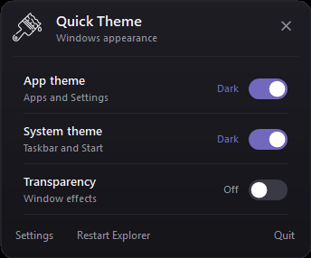
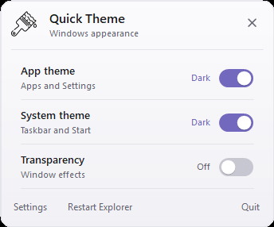
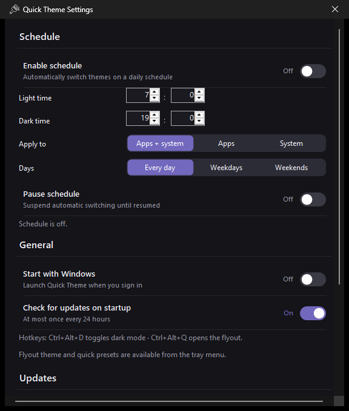

# Quick Theme

[](https://github.com/riad-boussaid/quick-theme/actions/workflows/release.yml)
[](https://github.com/riad-boussaid/quick-theme/releases/latest)
[](LICENSE)

A small, open-source Windows tray utility for switching the Windows light/dark appearance without opening Settings.

<p align="center">
  
  
</p>



## Download

Grab the latest package from [GitHub Releases](https://github.com/riad-boussaid/quick-theme/releases/latest):

- **Installer** — per-user install under `%LOCALAPPDATA%\Programs\Quick Theme`
- **Portable zip** — extract and run `quick-theme.exe`

Published builds are self-contained and do not require the .NET runtime.

## Features

- Dark **or light** flyout theme, or follow Windows automatically
- Toggle **apps** and **system** light/dark mode
- Toggle Windows **transparency**
- Daily **light/dark schedule** with pause and weekday/weekend rules
- Settings window for schedule, startup, updates, and about
- Presets: all dark, all light, or apps follow system
- Quick toggles in the tray menu, plus middle-click for a full dark/light switch
- Global hotkeys: `Ctrl+Alt+D` toggles dark mode, `Ctrl+Alt+Q` opens the flyout
- Live refresh when the theme is changed from Windows Settings or another tool
- Uses your Windows accent color
- Tray icon automatically switches between light and dark variants
- Optional "Start with Windows"
- Optional Explorer restart to apply system colors to the taskbar
- Single instance: launching it again just reopens the flyout
- CLI switches for scripts and shortcuts
- Built-in update check and self-update
- Windows 10/11, per-monitor DPI aware

## Requirements

To build:

- Windows 10 or later
- [.NET 10 SDK](https://dotnet.microsoft.com/download)
- Inno Setup 6 (optional, only for building the installer)

Published builds are self-contained and do not require the .NET runtime.

## Build

```powershell
git clone https://github.com/riad-boussaid/quick-theme.git
cd quick-theme
.\build.ps1
```

or, with a .NET 10 SDK on `PATH`:

```powershell
dotnet build -c Release
```

The framework-dependent executable is written to `bin\Release\net10.0-windows\quick-theme.exe`.

## Test

```powershell
.\test.ps1
```

or, with a .NET 10 SDK on `PATH`:

```powershell
dotnet test tests\QuickTheme.Tests\QuickTheme.Tests.csproj
```

## Package

```powershell
.\publish.ps1
```

This creates:

- `artifacts\quick-theme.exe` — self-contained, single-file executable
- `artifacts\quick-theme-<version>-win-x64.zip` — portable package
- `artifacts\update.json` — update manifest with SHA-256 hash
- `artifacts\quick-theme-<version>-setup.exe` — per-user installer, when Inno Setup 6 is installed

Useful options:

```powershell
.\publish.ps1 -Version 1.3.0
.\publish.ps1 -FeedUrl "https://example.com/quick-theme/update.json"
.\publish.ps1 -UpdateUrl "https://example.com/quick-theme/quick-theme.exe"
.\publish.ps1 -SkipInstaller
```

The generated manifest points at `quick-theme.exe` by default. If you host the manifest
and executable in the same directory, the relative URL just works.

## Usage

Run `quick-theme.exe`. It lives in the notification area:

- **Left click** the tray icon to open or close the flyout.
- **Middle click** toggles apps and system themes together.
- **Right click** for quick toggles, presets, flyout theme, schedule pause, Settings,
  updates, About, Start with Windows, and Quit.
- `Ctrl+Alt+D` toggles dark mode from anywhere.
- `Ctrl+Alt+Q` opens the flyout from anywhere.
- The flyout closes when it loses focus or when `Esc` is pressed.

### Schedule

Open **Settings** from the flyout footer or the tray menu. The schedule supports:

- Separate light and dark times
- Applying to apps + system, apps only, or system only
- Every day, weekdays, or weekends
- Pausing and resuming without losing the configured times

The schedule is applied on startup, after sleep/resume or clock changes, and at each
transition. Manual theme changes stay in effect until the next scheduled transition.

### Presets

Use the **Presets** submenu in the tray menu for:

- **All dark**
- **All light**
- **Apps follow system**

### Flyout theme

Choose **System**, **Dark**, or **Light** under **Flyout theme** in the tray menu.
The setting is saved and applied immediately.

## Command line

```powershell
quick-theme.exe            # start in the tray
quick-theme.exe --show     # open the flyout immediately
quick-theme.exe --dark     # switch apps + system to dark
quick-theme.exe --light    # switch apps + system to light
quick-theme.exe --toggle   # swap apps + system between dark and light
```

Theme commands apply immediately and exit if the tray app is not running. If it is
already running, the open flyout and tray icon refresh automatically.

## Settings

Settings are stored in:

```
%APPDATA%\Quick Theme\settings.json
```

Example:

```json
{
  "FlyoutTheme": "System",
  "UpdateFeedUrl": "",
  "CheckForUpdatesOnStartup": true,
  "LastUpdateCheckUtc": "2026-11-09T13:00:00+00:00",
  "ScheduleEnabled": false,
  "SchedulePaused": false,
  "ScheduleLightTime": "07:00:00",
  "ScheduleDarkTime": "19:00:00",
  "ScheduleScope": "Both",
  "ScheduleDays": "EveryDay"
}
```

| Setting | Meaning |
| --- | --- |
| `FlyoutTheme` | `System`, `Dark`, or `Light` |
| `UpdateFeedUrl` | URL or local path to `update.json` |
| `CheckForUpdatesOnStartup` | Check at most once every 24 hours when `true` |
| `LastUpdateCheckUtc` | Maintained by the app |
| `ScheduleEnabled` | Turn the daily schedule on or off |
| `SchedulePaused` | Temporarily suspend scheduled switching |
| `ScheduleLightTime` | Local time for the light theme |
| `ScheduleDarkTime` | Local time for the dark theme |
| `ScheduleScope` | `Both`, `Apps`, or `System` |
| `ScheduleDays` | `EveryDay`, `Weekdays`, or `Weekends` |

You can override the update feed for a session with an environment variable:

```powershell
$env:QUICKTHEME_UPDATE_FEED = "C:\path\to\update.json"
```

## Updates

The app checks an update manifest like this:

```json
{
  "version": "1.3.0",
  "url": "quick-theme.exe",
  "sha256": "lowercase-sha256-of-the-exe",
  "notes": "What changed in this version"
}
```

The manifest URL comes from `UpdateFeedUrl`, the `QUICKTHEME_UPDATE_FEED` environment
variable, or an update feed embedded at publish time with `publish.ps1 -FeedUrl ...`.

When an update is available:

1. The tray menu changes to **Update to x.y.z...**
2. The app downloads the new executable to `%TEMP%\Quick Theme`
3. The SHA-256 hash is verified
4. A small hidden PowerShell script waits for the app to exit, replaces the executable,
   and restarts it

The app folder must be writable by the current user. The included installer installs
under `%LOCALAPPDATA%\Programs\Quick Theme` for this reason.

## CI

`.github/workflows/release.yml` builds the portable package and installer on every push
and pull request. Pushing a `v*` tag creates a GitHub release with:

- `quick-theme.exe`
- `update.json`
- portable zip
- installer

The release build embeds a `latest/download/update.json` feed URL, so tagged releases
can update themselves through GitHub Releases.

## How it works

The app writes these values under
`HKCU\Software\Microsoft\Windows\CurrentVersion\Themes\Personalize`:

| Value | Meaning |
| --- | --- |
| `AppsUseLightTheme` | `0` = dark apps, `1` = light apps |
| `SystemUsesLightTheme` | `0` = dark system, `1` = light system |
| `EnableTransparency` | `0` = off, `1` = on |

Some already-running apps only pick up changes on restart. The taskbar and Start menu
usually need Explorer to restart; use **Restart Explorer** in the flyout for that.

The app listens for Windows theme-change broadcasts, so changes made from Windows
Settings (or another tool) refresh the flyout and tray icon immediately.

## Contributing

Issues and pull requests are welcome. See [CONTRIBUTING.md](CONTRIBUTING.md) for the
project layout, build commands, and pull-request expectations.

## Security

Please report vulnerabilities privately through GitHub's advisory feature. See
[SECURITY.md](SECURITY.md) for details and update-integrity notes.

## License

Quick Theme is released under the [MIT License](LICENSE).
